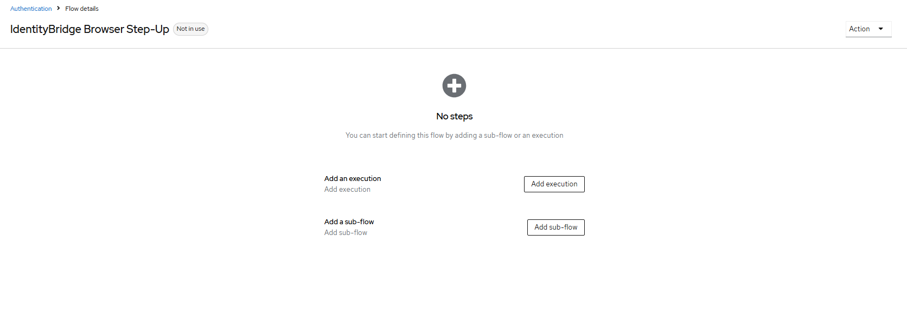
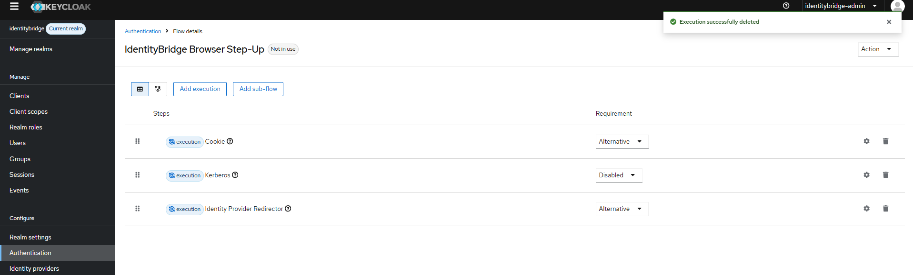
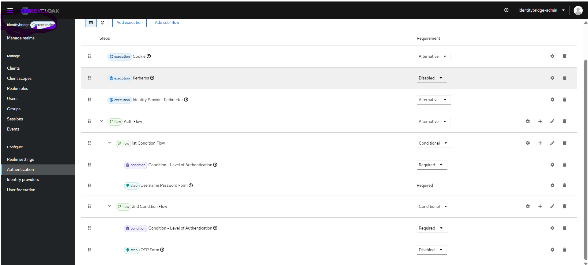
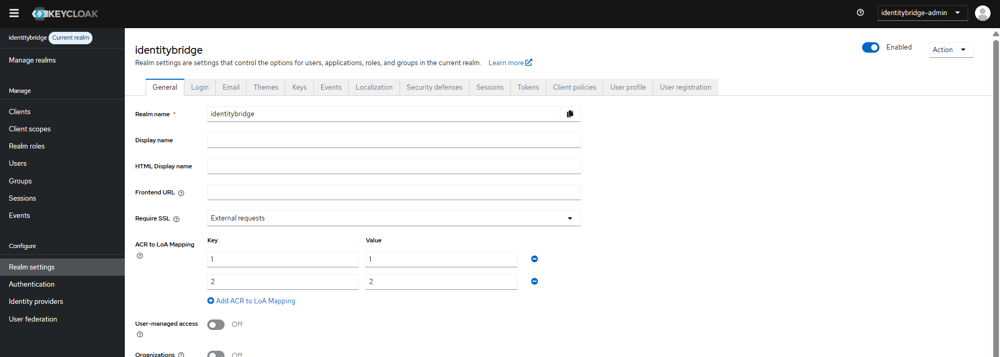
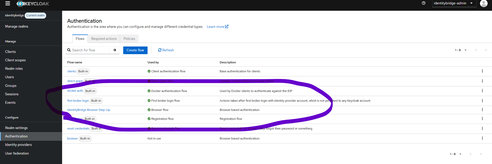

# Keycloak Browser Step-Up MFA — Visual Setup Guide

This guide records the IdentityBridge Keycloak browser step-up configuration completed on **10 November 2026**. It is written as a beginner walkthrough and includes the screenshots captured during the setup.

> **Scope:** These steps apply to the `identitybridge` realm. Do not perform them in the `master` realm. The built-in `browser` flow in `master` must remain unchanged.

## 1. What this configuration does

IdentityBridge uses Keycloak for OpenID Connect (OIDC) login. A normal login establishes the application session. When a protected operation requires stronger authentication, IdentityBridge starts a step-up request asking Keycloak for authentication assurance level `2` (ACR `2`). The configured browser flow uses a password step for Level 1 and a one-time password (OTP/TOTP) step for Level 2.

Key terms:

- **Realm:** A Keycloak security boundary containing users, clients, roles and authentication configuration.
- **Authentication flow:** An ordered set of steps Keycloak runs during sign-in.
- **Sub-flow:** A smaller flow nested inside another flow.
- **Requirement:** `Required` means the step must succeed; `Alternative` means another alternative can satisfy the parent; `Conditional` means the sub-flow runs when its conditions apply.
- **ACR:** OpenID Connect Authentication Context Class Reference. IdentityBridge expects `acr=2` for successful step-up.
- **LoA:** Keycloak Level of Authentication. The realm maps ACR values to LoA values.

## 2. Select the correct realm

1. Open the Keycloak Admin Console.
2. Use the realm selector in the upper-left corner.
3. Select **identitybridge**.
4. Confirm the console identifies `identitybridge` as the current realm before changing anything.

Do not create or bind this flow in `master`.

## 3. Create the dedicated flow

Navigate to **Authentication → Flows → Create flow**. Create a flow named:

- **Name:** `IdentityBridge Browser Step-Up`
- **Type:** Basic flow (or duplicate the built-in Browser flow and rename the copy, as done for this setup)
- **Description:** `Browser based authentication`

The custom flow is separate from the built-in flow. The screenshots show the initial flow and its base executions.





The base executions retained in the custom flow are:

| Execution | Requirement |
|---|---|
| Cookie | Alternative |
| Kerberos | Disabled |
| Identity Provider Redirector | Alternative |
| Auth Flow | Alternative |

## 4. Configure the authentication sub-flows

Inside `Auth Flow`, create two conditional sub-flows.

### 4.1 Level 1 — password

Create `1st Condition Flow` with requirement **Conditional**. Add these executions in this order:

| Execution | Requirement |
|---|---|
| Condition - Level of Authentication | Required |
| Username Password Form | Required |

Configure **Condition - Level of Authentication**:

| Setting | Value |
|---|---|
| Alias | `Level 1` |
| Authenticator Reference | `1` |
| Level of Authentication (LoA) | `1` |
| Max Age | `36000` seconds |

### 4.2 Level 2 — OTP/TOTP

Create `2nd Condition Flow` with requirement **Conditional**. Add:

| Execution | Requirement |
|---|---|
| Condition - Level of Authentication | Required |
| OTP Form | Required |

Configure the Level 2 condition:

| Setting | Value |
|---|---|
| Alias | `Level 2` |
| Authenticator Reference | `2` |
| Level of Authentication (LoA) | `2` |
| Max Age | `0` seconds |

Ensure **OTP Form is Required**, not Disabled. The user account must have a TOTP credential enrolled before this challenge can succeed.



## 5. Configure ACR-to-LoA mapping

Navigate to **Realm settings → General → ACR to LoA Mapping** in the `identitybridge` realm.

Add these key/value pairs:

| Key (ACR) | Value (LoA) |
|---:|---:|
| `1` | `1` |
| `2` | `2` |

Save the realm settings. The captured screenshot shows both mappings configured.



## 6. Bind the custom flow to the Browser flow

In **Authentication → Flows**, open `IdentityBridge Browser Step-Up` and select **Action → Bind flow → Browser flow**. Confirm the operation while the current realm is `identitybridge`.

After binding, the flow list should show `IdentityBridge Browser Step-Up` as **Used by: Browser flow**. Do not bind it in `master`.



## 7. Test the end-to-end login and step-up

Start the API from Git Bash in the repository root:

```bash
uv run uvicorn identitybridge.main:app --app-dir src --host 127.0.0.1 --port 8000
```

Keep that terminal open. In the same browser profile:

1. Open `http://localhost:8000/auth/login` and complete the normal Keycloak login.
2. Open `http://localhost:8000/auth/step-up` while still signed in.
3. Complete the password/OTP challenge if Keycloak presents it.
4. Confirm the callback returns `303 See Other` and the application home page returns `200 OK`.
5. Open `http://localhost:8000/auth/me` in the same browser session and confirm the authenticated user and expected application roles are returned.

### Recorded test evidence (10 November 2026)

The test session produced:

```text
GET /auth/callback ... 303 See Other
GET / ... 200 OK
```

The subsequent `/auth/me` response returned the signed-in subject and the `identity-admin` role. The step-up callback did not emit the prior `OIDC step-up rejected` warning. This demonstrates that the application accepted the step-up callback and retained the authenticated session.

**Important evidence limitation:** `/auth/me` returns identity and role details; it does not expose the internal session assurance object. The successful step-up callback is the evidence that the application validator accepted the returned OIDC assurance claims. Do not publish raw tokens, authorization codes, cookies, passwords, OTP values or client secrets in documentation or screenshots.

## 8. Troubleshooting

### Callback returns `401 Required step-up authentication was not satisfied`

Check the Uvicorn log for the sanitized diagnostic line. The earlier failure showed `acr='1'`, which meant the requested Level 2 assurance had not been achieved. Verify:

1. The custom flow is in the `identitybridge` realm.
2. The custom flow is bound as that realm's Browser flow.
3. The Level 2 condition has Authenticator Reference `2`, LoA `2`, and Max Age `0`.
4. OTP Form is `Required`.
5. The realm has ACR `1` → LoA `1` and ACR `2` → LoA `2` mappings.
6. The user has enrolled a TOTP credential.

Do not weaken the application-side assurance validator to make the callback pass. Fix the Keycloak flow/mapping and retest.

### `curl` returns `401 Authentication required`

A browser login cookie is not automatically available to Git Bash `curl`. `curl -b cookies.txt` only works if that file contains a valid cookie for this application. Test `/auth/me` in the same browser profile that completed login, or use an explicitly exported test cookie only in a controlled local test (never share it).

### Admin Console shows the wrong realm

Use the realm selector and confirm `identitybridge` is the current realm before inspecting or editing flows. The `master` realm is for Keycloak administration and must not receive the IdentityBridge application flow binding.

## 9. Security and operational notes

- Keep the Keycloak client secret and application `.env` file private. Never commit `.env`.
- If a credential is ever exposed, rotate it immediately and update the local secret store before deployment.
- Keycloak brute-force protection has been configured and verified in the local realm; production configuration must still be reviewed.
- Localhost HTTP and Keycloak development mode are for local development only. Production requires HTTPS and deployment-specific hardening.
- The screenshots are setup evidence, not a production security certification.

## 10. Completion checklist

- [x] Dedicated flow created in `identitybridge` realm.
- [x] Password Level 1 condition configured.
- [x] OTP Level 2 condition configured.
- [x] OTP execution set to Required.
- [x] ACR-to-LoA mappings configured (`1 → 1`, `2 → 2`).
- [x] Custom flow bound as Browser flow in `identitybridge` realm.
- [x] Real callback returned `303`; home returned `200`.
- [x] `/auth/me` returned authenticated identity and `identity-admin` role.
- [x] Rotate the previously exposed local client secret; credentials remain outside repository history.
- [x] Configure and verify local Keycloak brute-force protection.
- [ ] Complete deployment-specific production security review before production use.
